# MediLink — Plateforme Médicale Intelligente

**MediLink** est une application web de gestion médicale qui intègre l'intelligence artificielle pour la détection précoce du cancer de la peau. Elle couvre l'authentification multi-rôles, la prise de rendez-vous, le suivi des dossiers et un assistant médical conversationnel.

<p align="center">
  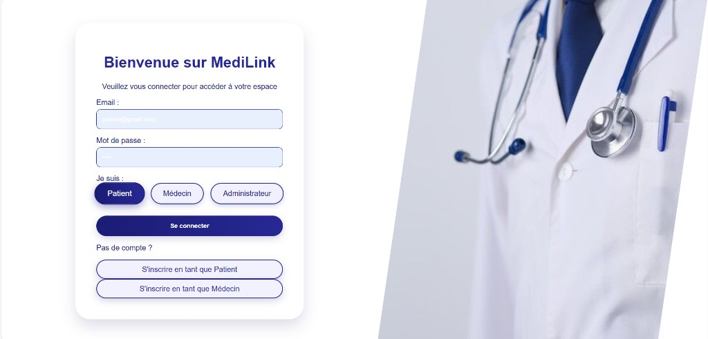
</p>

<p align="center">
  <em>Connexion multi-rôles — Patient, Médecin, Administrateur</em>
</p>

---

## Fonctionnalités

| Module | Description |
|--------|-------------|
| **Multi-rôles** | Espaces dédiés Patient, Médecin et Administrateur avec authentification sécurisée |
| **Détection IA** | Analyse d'images dermatoscopiques (ResNet-152, U-Net, EfficientNet-B4) |
| **Rendez-vous** | Calendrier interactif, disponibilités et gestion des statuts |
| **Chatbot médical** | Assistant intelligent basé sur Google Gemini |
| **Dossiers médicaux** | Historique et consultation sécurisée |
| **Tableaux de bord** | Statistiques et visualisations par rôle |
| **Notifications** | Alertes en temps réel (validations, confirmations de RDV) |

---

## Aperçu de l'interface

### Espace Patient

Espace personnel pour gérer le profil, les rendez-vous, le scanner cutané et le chatbot.

| Accueil patient | Mes rendez-vous |
|:---------------:|:---------------:|
| 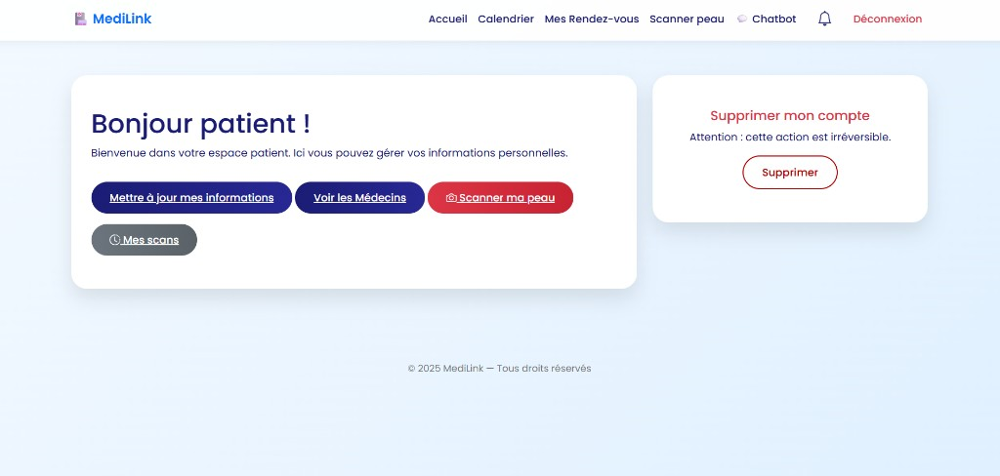 | 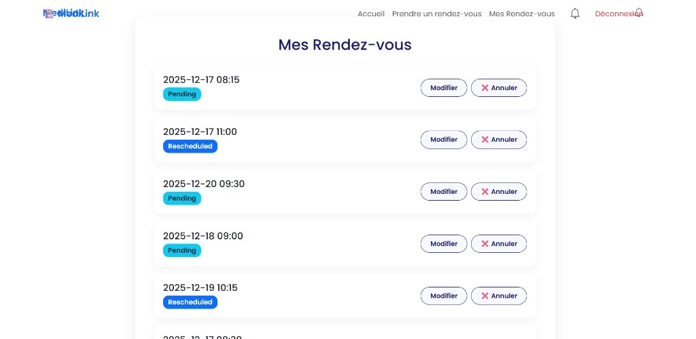 |

| Notifications | Scanner peau |
|:-------------:|:------------:|
| 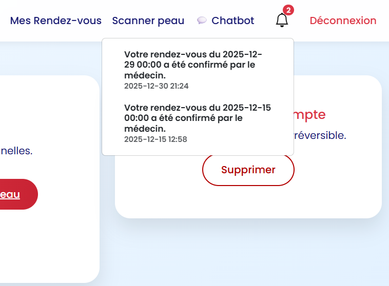 | 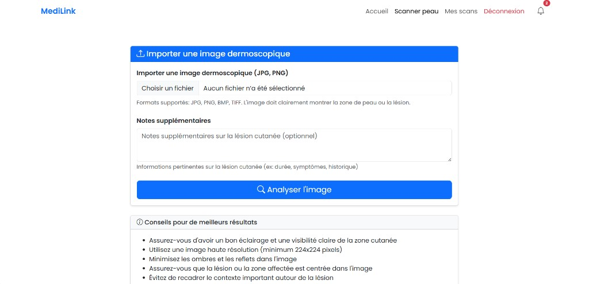 |

| Historique des scans | Chatbot médical |
|:--------------------:|:---------------:|
| 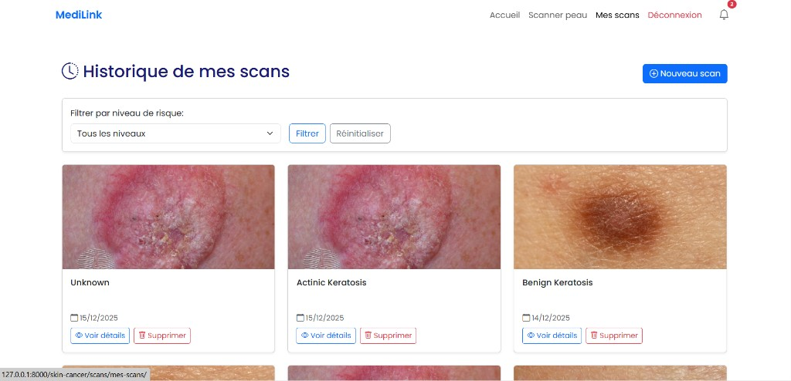 | 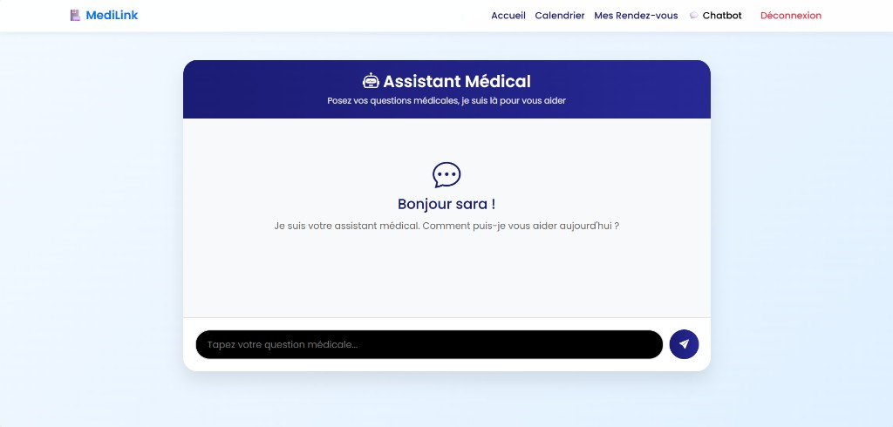 |

### Espace Médecin

Tableau de bord clinique, calendrier des disponibilités et validation des rendez-vous.

| Dashboard médecin | Calendrier des disponibilités |
|:-----------------:|:-----------------------------:|
| 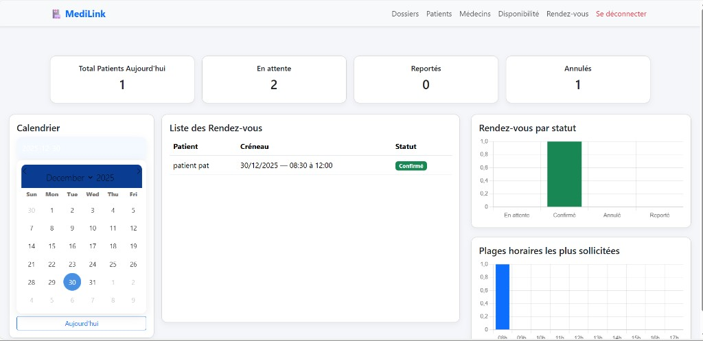 | 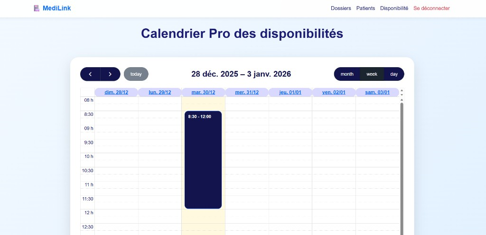 |

<p align="center">
  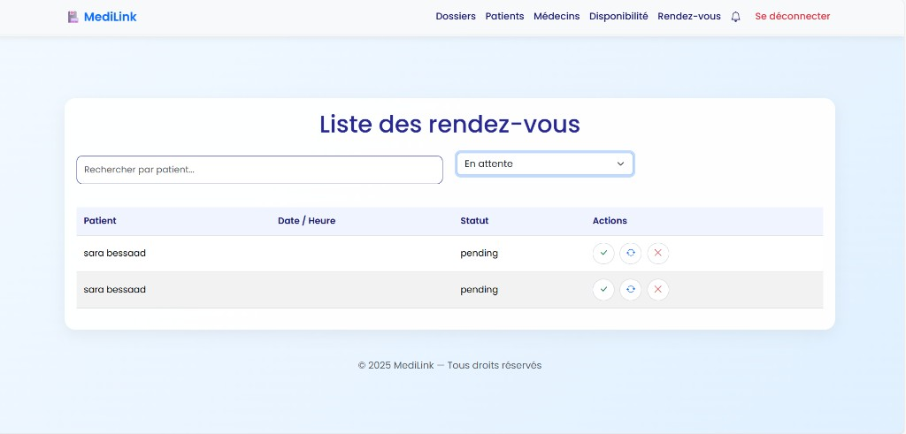
</p>
<p align="center"><em>Liste des rendez-vous — confirmer, reporter ou annuler</em></p>

### Espace Administrateur

Validation des médecins, statistiques globales et supervision des scans.

| Accueil admin | Statistiques |
|:-------------:|:------------:|
| 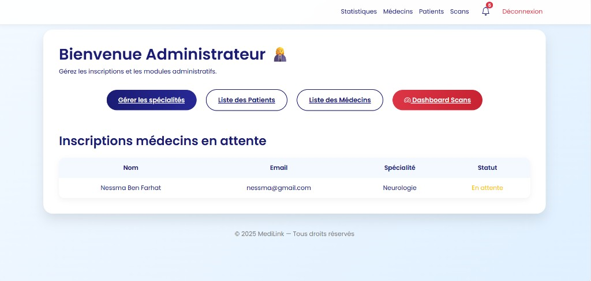 | 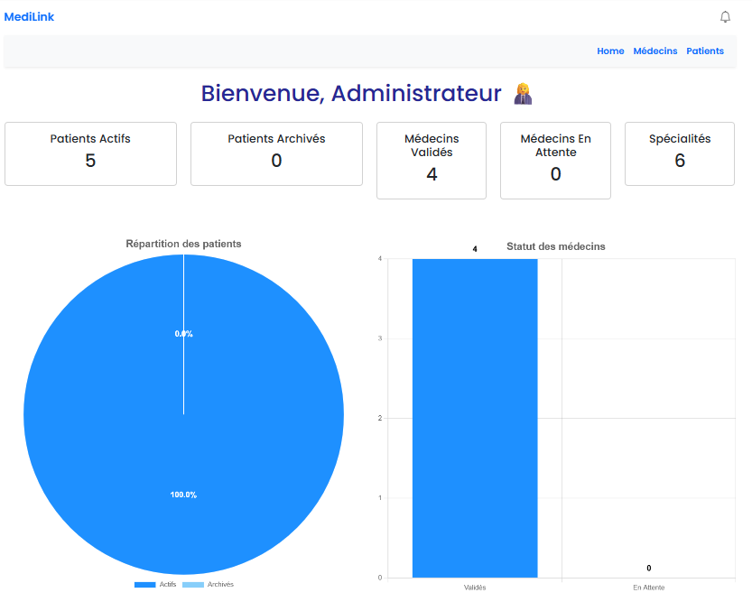 |

| Validation des médecins | Notifications admin |
|:-----------------------:|:-------------------:|
| 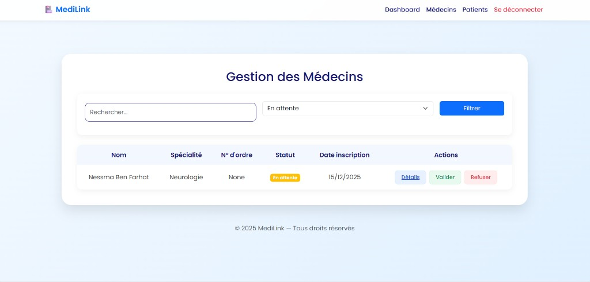 | 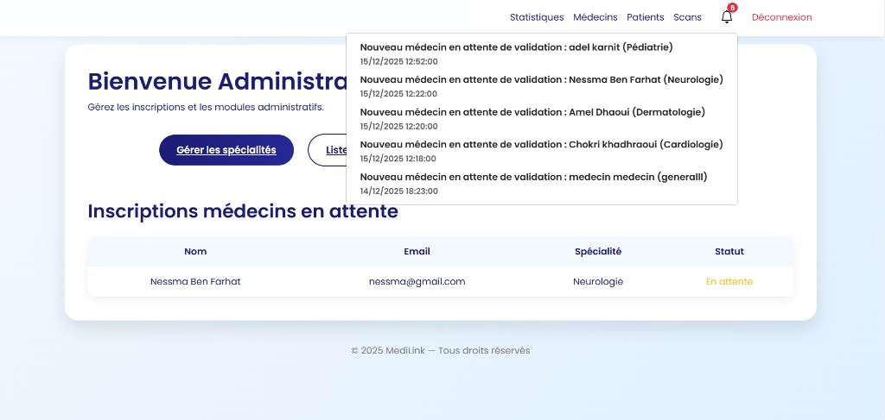 |

<p align="center">
  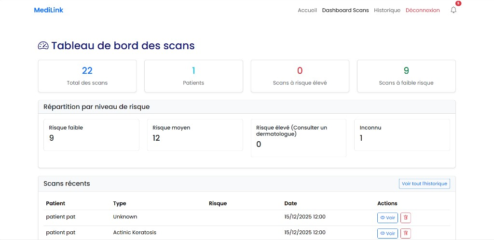
</p>
<p align="center"><em>Tableau de bord des scans — répartition par niveau de risque</em></p>

---

## Technologies

| Catégorie | Stack |
|-----------|-------|
| **Backend** | Django 4.0+, Python, SQLite, Django Signals |
| **Frontend** | HTML5, CSS3, Bootstrap 5, JavaScript, FullCalendar.js |
| **IA / ML** | TensorFlow, Keras, OpenCV, NumPy, ResNet-152, U-Net, EfficientNet-B4 |
| **APIs** | Google Gemini API |

### Pipeline de détection IA

```text
Upload → Preprocessing → Skin Detection → Segmentation → Classification → Résultats
```

---

## Installation

### Prérequis

- Python 3.8+
- pip

### Étapes

1. **Cloner le dépôt**

   ```bash
   git clone https://github.com/maramfarhat/MediLink.git
   cd MediLink
   ```

2. **Créer un environnement virtuel**

   ```bash
   python -m venv venv
   # Windows
   venv\Scripts\activate
   # macOS / Linux
   source venv/bin/activate
   ```

3. **Installer les dépendances**

   ```bash
   pip install -r requirements.txt
   ```

4. **Configurer l'API Gemini** (chatbot)

   Créer un fichier `.env` à la racine :

   ```env
   GEMINI_API_KEY=votre_cle_api
   ```

5. **Appliquer les migrations**

   ```bash
   python manage.py migrate
   ```

6. **Créer un superutilisateur** (optionnel)

   ```bash
   python manage.py createsuperuser
   ```

7. **Lancer le serveur**

   ```bash
   python manage.py runserver
   ```

L'application est accessible sur **http://127.0.0.1:8000/**

---

## Structure du projet

```text
MediLink/
├── medical/            # Configuration Django
├── users/              # Patients, médecins, administrateurs
├── dossiers/           # Dossiers médicaux
├── gestion_medecins/   # Validation et gestion des médecins
├── rendezvous/         # Prise et suivi des rendez-vous
├── disponibilite/      # Disponibilités des médecins
├── dashboard/          # Tableaux de bord
├── chatbot/            # Assistant médical (Gemini)
├── specialite/         # Spécialités médicales
├── templates/          # Templates HTML partagés
├── static/             # Assets statiques
├── docs/screenshots/   # Captures d'écran (README)
└── requirements.txt
```

---

## Routes principales

| URL | Description |
|-----|-------------|
| `/` | Accueil et authentification |
| `/admin/` | Administration Django |
| `/dossiers/` | Dossiers médicaux |
| `/medecins/` | Gestion des médecins |
| `/rendezvous/` | Rendez-vous |
| `/dashboard/` | Tableaux de bord |
| `/chatbot/` | Chatbot médical |
| `/skin-cancer/` | Détection IA du cancer de la peau |

---

## Auteurs

Développé dans le cadre d'un projet de plateforme médicale intelligente.

---

<p align="center">
  <sub>© 2025 MediLink — Tous droits réservés</sub>
</p>
